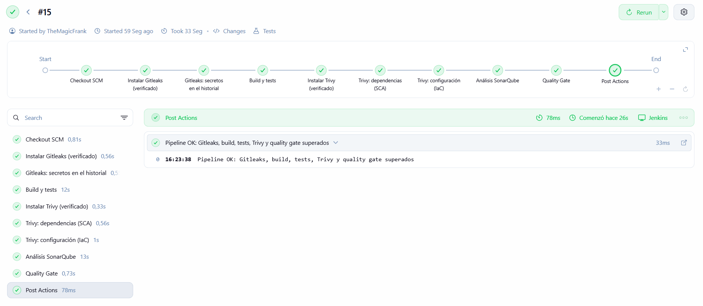
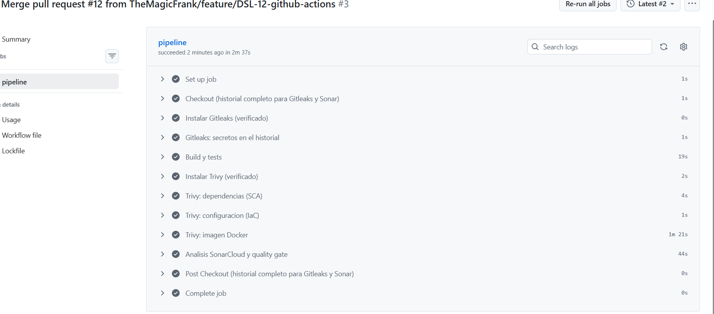
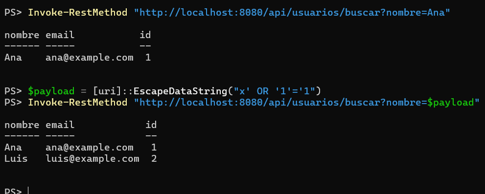
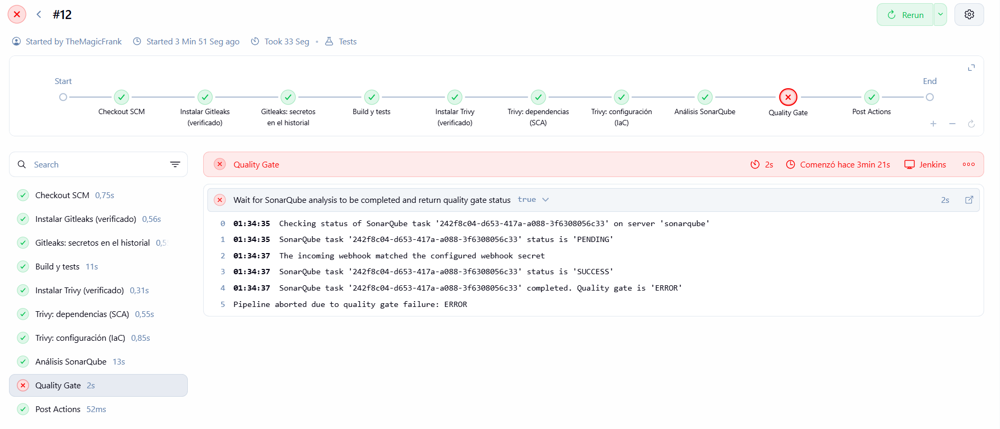
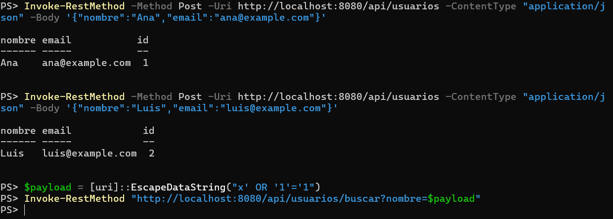
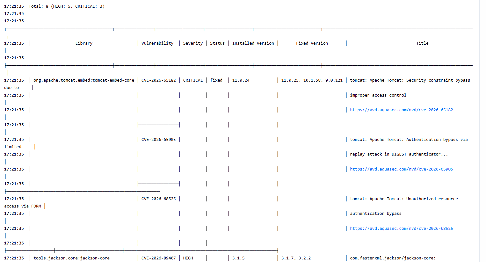
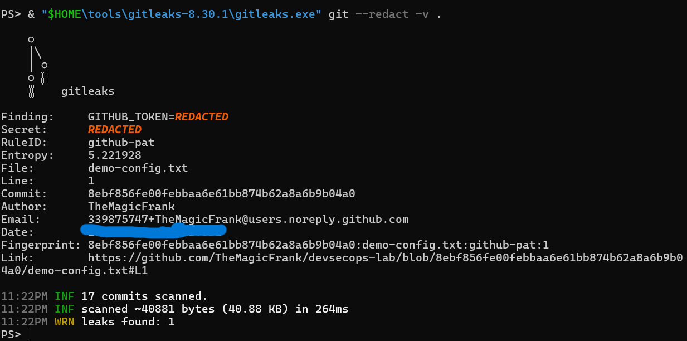
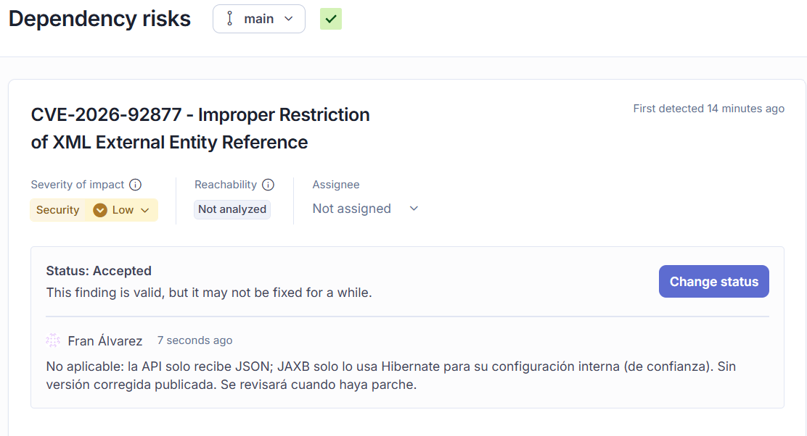
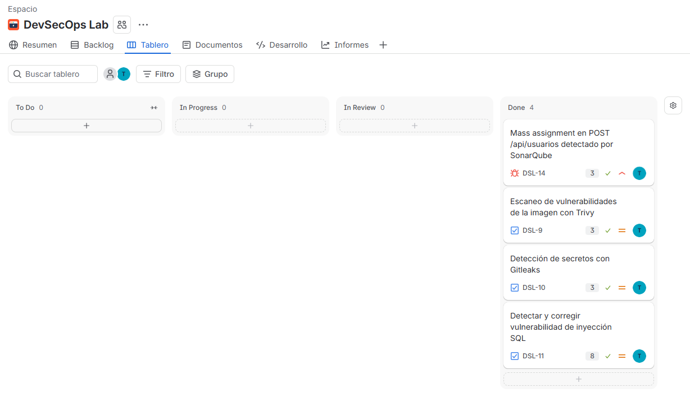

# devsecops-lab

[](https://github.com/TheMagicFrank/devsecops-lab/actions/workflows/ci.yml)
[](https://sonarcloud.io/summary/new_code?id=TheMagicFrank_devsecops-lab)

Laboratorio DevSecOps montado desde cero: una API REST en **Java 21 + Spring Boot 4.1.1** con un pipeline de CI que integra la seguridad en cada paso. El mismo pipeline funciona en **Jenkins** (local, con Docker) y en **GitHub Actions** (nube, con SonarQube Cloud). Todo el trabajo se planificó en sprints de **Jira**, con una rama y una Pull Request revisada por cada tarea o bloque de trabajo.

📄 **Guía completa con todas las capturas, paso a paso:** [`docs/guia-devsecops-lab.pdf`](docs/guia-devsecops-lab.pdf)

## Pipeline

Cada cambio pasa por estas etapas. Si una falla, el pipeline se para y el código no se integra.

| # | Etapa | Qué controla |
|---|---|---|
| 1 | Instalar Gitleaks (verificado) | Versión fijada y SHA-256 comprobado antes de ejecutar nada |
| 2 | Gitleaks: secretos en el historial | Ningún secreto en ningún commit; si aparece, se para antes de compilar |
| 3 | Build y tests | Compilación con Maven y tests (servicio, controlador y regresión de seguridad) |
| 4 | Instalar Trivy (verificado) | Misma cadena de confianza que Gitleaks |
| 5 | Trivy: dependencias (SCA) | CVE HIGH/CRITICAL con parche disponible en las librerías |
| 6 | Trivy: configuración (IaC) | Malas configuraciones en el Dockerfile |
| 7 | Análisis SonarQube (SAST) | Vulnerabilidades, bugs y code smells en el código |
| 8 | Quality Gate | Si el código no cumple, el pipeline falla |

GitHub Actions ejecuta el mismo orden y añade el **escaneo de la imagen Docker** con Trivy.





## Stack

| Área | Herramienta |
|---|---|
| Aplicación | Java 21, Spring Boot 4.1.1, Spring Data JPA, H2, Maven |
| Contenedores | Docker (multi-stage, JRE 21 Alpine), docker-compose |
| CI | Jenkins LTS (JDK 21), GitHub Actions |
| SAST | SonarQube Community (local), SonarQube Cloud |
| SCA, IaC e imagen | Trivy 0.75.0 |
| Secretos | Gitleaks 8.30.1 |
| Dependencias | Dependabot (Maven, Docker, docker-compose y GitHub Actions) |
| Gestión | Jira (Scrum) |

## Vulnerabilidades encontradas y corregidas

| Hallazgo | Detectado por | Resolución |
|---|---|---|
| **Mass assignment** (High) en `POST /api/usuarios`: el controlador recibía la entidad JPA y se podía sobrescribir otro usuario enviando `"id"` | SonarQube | Explotado en local, corregido con un DTO y test de regresión, y verificado con el mismo ataque (DSL-14) |
| **Inyección SQL** introducida a propósito en `GET /api/usuarios/buscar` | SonarQube + quality gate | Pipeline en rojo; corregida con consulta parametrizada y 2 tests de regresión (DSL-11) |
| **8 CVE** (3 CRITICAL en Tomcat 11.0.24, 5 HIGH en Jackson 3.1.5) | Trivy SCA | Versiones corregidas fijadas en el `pom.xml` (Tomcat 11.0.25, Jackson 3.1.7) (DSL-9) |
| Token falso commiteado y borrado (demostración en una rama local nunca subida) | Gitleaks | Detectado en el historial aunque se borró en el commit siguiente (DSL-10) |
| 2 CVE transitivas (JAXB XXE, Logback path traversal) | SonarQube Cloud SCA | No aplicables al proyecto: aceptadas con justificación escrita (DSL-12) |

### Inyección SQL: antes y después

**1. Exploit:** con `x' OR '1'='1` la búsqueda devuelve todos los usuarios.



**2. El pipeline lo bloquea:** SonarQube detecta la consulta construida dinámicamente y el quality gate falla.



**3. Corregido:** con la consulta parametrizada, el mismo payload ya no devuelve nada.



### Trivy bloqueando dependencias vulnerables



### Gitleaks detectando un secreto en el historial



### Riesgo aceptado con justificación



## Decisiones de seguridad

- **Mínimo privilegio:** el contenedor corre con el usuario `app` (no root) y el `.jar` pertenece a root, así que la aplicación no puede modificarse a sí misma. Tokens de SonarQube limitados a un proyecto, solo análisis y con caducidad. `permissions: contents: read` en Actions.
- **Exponer lo mínimo:** Jenkins, SonarQube y la app se publican solo en `127.0.0.1`; PostgreSQL no publica ningún puerto; consola H2 desactivada.
- **Secretos fuera del código:** contraseñas en `.env` (ignorado por Git; solo se sube `.env.example`), credenciales cifradas en Jenkins y secrets en GitHub. Usuarios por defecto cambiados (`admin/admin` de SonarQube, sin usuario `admin` en Jenkins).
- **Cadena de suministro:** Gitleaks, Trivy y el plugin de Sonar con versión fijada; binarios verificados con SHA-256 (por el ataque a la cadena de suministro de Trivy de marzo de 2026); imágenes base fijadas por `etiqueta@sha256`; `actions/checkout` fijada por SHA de commit; Dependabot revisado a mano (se ignoran los saltos de versión mayor).
- **Webhook SonarQube → Jenkins:** SonarQube lo bloquea por su protección anti-SSRF (red interna de Docker). Se desactiva esa validación y se compensa con un **secreto HMAC**: Jenkins solo acepta avisos firmados.
- **GitHub Actions sin exponer secretos:** el trigger es `pull_request` (no `pull_request_target`), así que las PR que vengan de forks no reciben secrets, y `SONAR_TOKEN` solo existe en el paso del análisis, no en todo el job.
- **Sin `docker.sock` en Jenkins:** montarlo daría control del host al contenedor. El escaneo de la imagen se hace en local y en GitHub Actions.

## Estructura

```
.
├── app/                     # API Spring Boot + Dockerfile multi-stage
├── docs/
│   ├── guia-devsecops-lab.pdf
│   └── img/                 # capturas del laboratorio
├── .github/
│   ├── dependabot.yml
│   └── workflows/ci.yml     # pipeline de GitHub Actions
├── Jenkinsfile              # pipeline de Jenkins
├── docker-compose.yml       # Jenkins + SonarQube + PostgreSQL
└── .env.example             # plantilla de secretos (el .env real no se sube)
```

## Cómo levantarlo

Requisitos: Java 21, Git y Docker Desktop (con WSL 2 en Windows).

```powershell
git clone https://github.com/TheMagicFrank/devsecops-lab.git
cd devsecops-lab

# Secretos locales: copia la plantilla y pon tu propia contraseña
Copy-Item .env.example .env

# Jenkins (http://localhost:8081) + SonarQube (http://localhost:9000) + PostgreSQL
docker compose up -d
docker compose ps
```

La aplicación por separado:

```powershell
cd app
.\mvnw.cmd test
docker build -t devsecops-lab-app .
docker run -d --name devsecops-app -p 127.0.0.1:8080:8080 devsecops-lab-app
```

La configuración de Jenkins y SonarQube (token, credenciales, webhook con HMAC y trabajo Pipeline) está explicada paso a paso en la [guía](docs/guia-devsecops-lab.pdf).

## Trabajo con Jira

Espacio Scrum **DevSecOps Lab** (clave `DSL`) con los estados To Do, In Progress, In Review y Done. Cuatro sprints, una rama y una PR por tarea o bloque de trabajo, y commits con la clave de Jira.



## Riesgos conocidos y mejoras pendientes

- Jenkins ejecuta los trabajos en el nodo principal (en producción, agentes separados); corre sobre Java 21 (fin de soporte en septiembre de 2027) y con la CSP desactivada.
- Cobertura de tests al 0 % en SonarQube: falta añadir la medición de cobertura.
- Falta un test de regresión a nivel HTTP para el mass assignment.
- Versiones de Tomcat y Jackson forzadas en el `pom.xml`: quitarlas cuando Spring Boot las incluya.
- Trivy 0.76.0 disponible: actualizar con la misma verificación.
- Token de SonarQube Cloud con caducidad el 13 de enero de 2027: rotar.
- La contraseña de PostgreSQL del `.env` se generó con `Get-Random`, que no es criptográficamente seguro. Vale para un laboratorio local; para un entorno real, usar `RandomNumberGenerator`.
- Las 2 CVE transitivas aceptadas (JAXB y Logback) se revisarán al actualizar Spring Boot.

## Licencia

[MIT](LICENSE)
